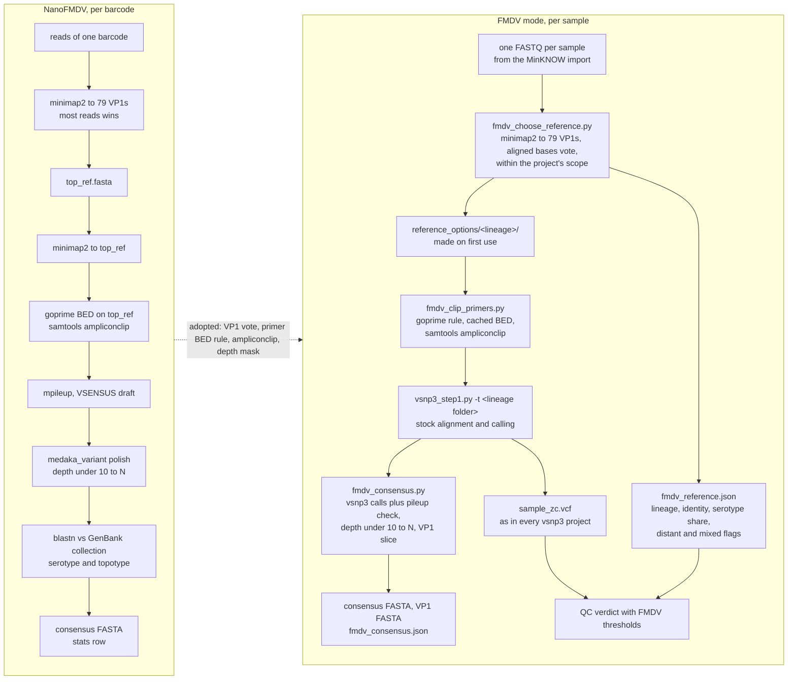
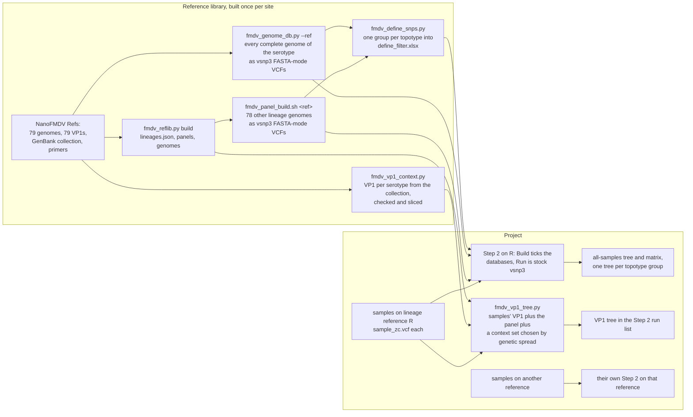

# FMDV mode: handoff for review and trial

Branch `fmdv-mode` of `kapurlab/vsnp_gui`, written 14 to 16 November 2026
for Tod Stuber and anyone else who will try it, review it, or decide what,
if anything, goes into `main`. Draft pull request kapurlab/vsnp_gui#14
holds the diff. `FMDV_MODE.md` in this folder is the design
and the measurements. This file is the state: what the branch is, how to
run it, what is verified, what is not, and the questions that need an
answer before it is merged.

## Background: NanoFMDV, and the problem it solves

AHI's sequencing protocol is NanoFMDV (Shaw et al. 2025, BMC Genomics,
doi 10.1186/s12864-025-11938-7; code at `github.com/rjorton/nanofmdv`):
tiled amplicons over the FMDV genome from a 33-primer scheme, barcoded,
sequenced on a MinION, and a per-barcode bash pipeline that turns each
barcode's reads into one typed consensus genome. The pipeline has no SNP
calling, no comparison between samples and no tree. Its unit of output is
one consensus FASTA and one row of statistics per barcode.

Per barcode, `nanofmdv_single_barcode.sh` runs:

1. **Reference choice by VP1 vote.** minimap2 (`map-ont`) maps the reads to
   `fmdv_vp1.fasta`, the VP1 sequences of 79 near-complete genomes drawn
   from FMDbase at roughly one per lineage. The VP1 with the most mapped
   reads names the reference; its full genome is pulled from `fmdv.fasta`
   as `top_ref.fasta`. The reads are also mapped to the 79 complete genomes
   for statistics.
2. **Alignment to the chosen genome** with minimap2, secondary and
   supplementary alignments dropped.
3. **Primer clipping.** `goprime_comp.py` finds each primer's best binding
   window on the chosen reference and `goprime_bed.py` writes a BED;
   `samtools ampliconclip --hard-clip --both-ends --tolerance 50
   --filter-len 50` clips the alignments, and `samtools fastq` writes the
   clipped reads back out.
4. **Draft consensus.** `samtools mpileup` over the clipped BAM, then
   `VSENSUS.jar` calls a draft at a minimum depth of 10.
5. **Polished consensus.** `medaka_variant` on the clipped reads against
   the reference, then `medaka sequence --min_depth 10 --fill_char N`, so
   positions under ten reads are N.
6. **Typing.** `blastn` of the consensus against `fmdv-gbbase.fasta`, their
   collection of 11,153 GenBank FMDV sequences whose headers carry
   serotype, topotype, country, year and host; the top hits give the
   serotype and topotype call.
7. **Statistics** (`depth_charge.py`, `fmdvstats.sh`): depth, coverage,
   read counts and the BLAST call, one CSV row per barcode.

We built and ran it on 14 November 2026 before writing any code of our
own. The published install fails in five places (an environment file named
wrongly, no Java for VSENSUS so the typing column goes silently blank, and
so on); with a corrected environment the pipeline reproduces the paper's
own test dataset exactly (`SRR34371563` assembles to `PV524918` at every
called position). That build and its fixes are documented in the lab's
`NanoFMDV_test_report_2026-11-14.md`, outside this repository.

What NanoFMDV does not do is the question AHI will ask once more than one
sample exists: are these viruses the same, and how do they relate to each
other and to what GenBank holds? That is a reference-mapped SNP question,
which is what vsnp3 does. So the design is NanoFMDV's per-sample front end
where it is right, vsnp3 for everything from alignment on, and the two
joined by a rule vsnp3 did not need for MTBC: the reference is chosen per
sample, before Step 1, because FMDV lineages are too far apart for one
reference to serve (section "Why" in `FMDV_MODE.md`).

## What was adopted, what was changed, what was left out

| NanoFMDV stage | In FMDV mode | Why |
|---|---|---|
| 79 lineage genomes and their VP1 panel | adopted as the reference library, read from a NanoFMDV checkout at build time | one genome per lineage is the right granularity for a nanopore reference |
| Reference by VP1 vote, most reads wins | adopted and tightened: first 20,000 reads, primary alignments only, MAPQ 10 or more and 100 aligned bases, the vote counted in aligned bases, a 20-read minimum, whole genomes as fallback, restricted to the project's scope | the same answer on all ten trial samples, in under 1.5 s, with a record of the runner-up, the read identity and the serotype composition |
| (none) | added: `distant` and `mixed` flags from the vote, both review and never refusal | a sample from a lineage with no close genome must still run; crosstalk and co-infection must be visible |
| Primer binding sites by the goprime rule, BED per sample | adopted, reimplemented; computed once per reference and primer set and cached; a primer whose best fit is under 0.8 is left out and listed | an unconditional BED clips a random stretch where a serotype-specific primer does not bind |
| `samtools ampliconclip`, same settings | adopted; unmapped reads pass through | vsnp3's mapping rate must still describe the sample |
| minimap2 alignment to the chosen genome | replaced by `vsnp3_step1.py -t <lineage folder>` | vsnp3's alignment and calling produce the `_zc.vcf` that Step 2, the groups and the trees need |
| VSENSUS draft, medaka polish, depth mask 10 | replaced by a consensus built from vsnp3's own calls with a pileup check and the same depth-10 mask; no indels, coordinates stay the reference's | the consensus and the SNP calls then agree by construction; measured identical to medaka's on SAT1 and 99.8% on strains 10 to 14% from their reference. An indel-aware polish for GenBank submission is a later, separate step |
| blastn typing of the consensus | adopted, on the same GenBank VP1 collection: the nearest record names the serotype, the nearest annotated record within 3% names the topotype and lineage, with agreement over the top 20 | the reads vote names the nearest of 79 genomes, the typing the nearest of 9,000 VP1 records; on the Illumina trial that was Ind-2001/D where the vote said e, and PanAsia-2/ANT-10 where it said FAR-09 |
| Statistics CSV | replaced by vsnp3's stats and an FMDV QC verdict (genome covered, depth, mapping rate, distant, mixed) | the stock verdict judged an FMDV field sample by bacterial-isolate rules |
| Shell loop over barcode folders | replaced by a MinKNOW run import into vsnp_gui's one-file-per-sample layout, with a sample sheet | the barcode-to-sample step belongs in the GUI, and it is useful in stock mode too |
| (none) | added: Step 2 per reference with lineage and GenBank genome databases, defining-SNP groups per topotype, and a VP1 tree with a GenBank context set | the between-sample questions NanoFMDV does not ask |
| Per-barcode stats line | replaced by a one-page sample report (HTML and PDF) and a run report for the outbreak team, both written by the pipeline and rewritten when a tree is built | the people who act on the result do not open a GUI |

## Schematic

Per sample. NanoFMDV's pipeline on the left, FMDV mode on the right; the
dashed line marks where NanoFMDV's part ends and vsnp3 begins.



Per project. Step 2 is stock vsnp3 run once per lineage reference; what is
new is what sits beside the samples in the comparison, and the VP1 tree.



The lab's `FMDV_mode_workflow.html` draws the same two levels with the
divergence scale that motivates them; it is outside this repository.

## What the branch is

vsnp_gui gains a project mode, `"mode": "fmdv"` in `project.json`, in which
the reference genome is chosen per sample before Step 1 instead of once per
project. Everything after that choice is stock vsnp3: the same step1, the
same `_zc.vcf`, the same Step 2, groups, trees and viewer. The reason is in
`FMDV_MODE.md`: lineages of one FMDV serotype differ by up to 21% and
nanopore reads stop mapping past 10 to 15% divergence, so one reference per
project loses the capsid, and with it the typing signal, for most samples.

Against `main` at `2b5d1bf` (v0.4.139) the branch is 62 commits: 53
files touched, 12,120 lines added and 98 removed (the built `frontend/dist/`
and the lock file not counted). The branch carries a rebuilt
`frontend/dist/` so a checkout serves the FMDV interface without a build.

In FMDV mode Step 2 leads with VP1. The Step 2 pane opens on a VP1 tab
(typing table, tree build) and the results pane follows it; the
whole-genome SNP comparison is the second tab. The order follows the
questions an outbreak sample asks: which serotype and lineage, then, for
samples that share a lineage, how far apart. The stock panes are unchanged
in stock mode.

New, FMDV only, nothing in stock mode calls them:

| File | What it does |
|---|---|
| `bin/fmdv_reflib.py` | the reference library: the 79 NanoFMDV lineage genomes as a hierarchy, panels, and vsnp3 reference folders made on demand |
| `bin/fmdv_proteins.py` | writes the 12 FMDV mature proteins into each library record as CDS features, boundaries from the record's own `mat_peptide` features or transferred by protein alignment from an annotated genome, so Step 2 tables read `2B:H23Q` rather than `unlisted gene:H984Q, polyprotein` |
| `bin/fmdv_choose_reference.py` | the per-sample chooser: competitive minimap2 on the VP1 panel, whole genomes as fallback; writes `fmdv_reference.json` |
| `bin/fmdv_clip_primers.py` | amplicon primer clipping on the chosen reference, `samtools ampliconclip` |
| `bin/fmdv_consensus.py` | depth-masked consensus from vsnp3's own calls plus a pileup check, and the VP1 slice |
| `bin/fmdv_vp1_tree.py` | VP1 tree of the project's samples with the lineage panel and a GenBank context set, mafft plus raxmlHPC |
| `bin/fmdv_vp1_context.py` | builds the per-serotype VP1 context sets offline from NanoFMDV's GenBank collection, with a VP1 identity check and slicing from long records |
| `bin/fmdv_panel_build.sh` | calls the 78 other lineage genomes against one reference (vsnp3 step1 FASTA mode) as a Step 2 reference database |
| `bin/fmdv_genome_db.py` | the same for every complete genome of the reference's serotype in the collection |
| `bin/fmdv_define_snps.py` | derives one defining-SNP group per topotype into the reference's `define_filter.xlsx` |
| `bin/fmdv_vp1_type.py` | VP1 typing: blastn of the VP1 consensus against one database of the GenBank VP1 sets and the panel; nearest record, nearest annotated record, agreement; writes `fmdv_vp1_type.json` |
| `bin/fmdv_vp1_tables.py` | after a tree: each sample's neighbourhood (records within 3% of its nearest, cap 20, floor 5), the VP1 variable-site tables (nucleotide and amino acid, sorted and cascade, shaded as vsnp3's), and the neighbourhood trees (run-level and one per sample) pruned from the full tree |
| `bin/fmdv_sample_report.py` | the one-page sample report, HTML and PDF (weasyprint): call, flags, QC, reference, neighbourhood, tree figure, VP1 amino acid differences, VP1 in print |
| `bin/fmdv_run_report.py` | the run report for the outbreak team: summary in words, one table of calls with notes, serotype trees |
| `bin/fmdv_simulate.py` | the simulated MinKNOW run with an answer key (outbreak chain, spikes, dropout, distant genome, depth series) |
| `bin/fmdv_bench_nanofmdv.py` | compares our consensus with NanoFMDV's on the same reads |
| `backend/app/ont_import.py`, `frontend/src/OntRunImport.jsx` | MinKNOW run import: barcode folders to one FASTQ per sample. Not FMDV specific; works in stock mode |
| `frontend/src/FmdvScopePicker.jsx` | the scope picker (serotype, topotype or lineage, genome, each with Auto) |
| `frontend/src/FmdvVp1Panel.jsx`, `FmdvVp1Tree.jsx` | the Step 2 VP1 tab: typing table, Type VP1, Build VP1 tree per serotype |
| `frontend/src/FmdvVp1Results.jsx` | the VP1 half of Step 2 Results: run pills; Typing, Tree, Neighbours, Sites, Files; report links |
| `backend/app/test_fmdv_*.py`, `test_ont_import.py`, `test_vcf_reference_detect.py` | tests in the stock script style |
| `docs/FMDV_WALKTHROUGH_PRJNA693428.md`, `docs/SYN_synthetic_run1_answer_key/` | the walkthrough on public data, and the synthetic run's key |
| `conda_setup/environment.yml` | the fork's own tools beside the vsnp3 env: mafft, iqtree, seqkit, BLAST+ |
| `docs/FMDV_MODE.md`, this file | design, measurements, state |

Edits to stock files, every one gated on the mode flag or on an FMDV
library reference, so stock projects run the code they ran before:

- `backend/app/main.py` (827 lines added, 33 removed). The Step 1 dispatch
  (`_step1_dispatch`) runs the chooser, the clipper and the consensus per
  sample around `vsnp3_step1.py -t <lineage folder>`; `Step1Request` and
  the status routes carry the mode, the scope and the chooser's result;
  `_resolve_qc_thresholds` and the QC summary read a per-project threshold
  layer; Step 2 (`step2_run`, `step2_panels_get`, `_step2_reference_audit`,
  `_reference_panel_accessions`, `_reference_panels_by_name`,
  `step2_vcf_count`, `project_vcfs_list`) resolves a library reference to
  its folder on demand and filters databases by the comparison reference;
  `project_link_local` and the `/fmdv` routes switch the mode and scope.
- `frontend/src/App.jsx` (439 lines added, 46 removed). The FMDV checkbox
  and scope picker in Step 1, the FMDV column set in Step 1 Results
  (serotype, lineage, topotype by VP1, identity, consensus called), the
  VP1 tab first in the Step 2 pane and the matching tabs in the results
  pane, the "Compare on reference" select and the database tick boxes in
  the Build tab, the QC criteria panel and the report buttons. Build now
  asks the backend which databases are ticked before it imports, which
  fixes a stale-list race that exists in stock too.
- `frontend/src/TreeStandalone.jsx` and `tree/layout.js` (33 lines). The
  viewer takes `search=a,b,c` (several names lit), `midpoint=1`,
  `bootstrap=1` and `fit=1` from its URL. Stock links pass none and see no
  change.
- `backend/app/config.py` (5 lines). The default `vsnp_gui_deploy_path` is
  the running checkout, so a fork's runs record their own commit.
- `backend/app/qc_verdict.py` (35 lines). Two extra signals through the
  existing contamination hook: a distant reference and a mixed serotype,
  both review, never fail.
- `backend/app/step2_inventory.py` (7 lines). A library reference's
  folder counts as a reference location.

Nothing from NanoFMDV is in the repository. The 79 genomes, the VP1 panel,
the GenBank collection and the primer scheme are read from a NanoFMDV
checkout at library build time (NanoFMDV, Shaw et al. 2025,
`github.com/rjorton/nanofmdv`, which carries no licence file, so its data
is not redistributed here).

## How to run it

Prerequisites beyond a working vsnp_gui:

1. The vsnp3 env on PATH when the backend starts, as for stock. The FMDV
   scripts use its `minimap2`, `samtools`, `bcftools` and `raxmlHPC`.
2. The fork's own env for mafft, iqtree, seqkit and BLAST+:
   `mamba env create -f conda_setup/environment.yml`, then put its `bin` on
   PATH as well. (BLAST+ was added to the file on 15 November and that
   install has not been exercised; on the development server BLAST+ came
   from the system.)
3. A NanoFMDV checkout for its `pipeline_exec/Refs/fmdv.fasta` (79 lineage
   genomes), `Refs/fmdv_vp1.fasta` (their VP1 sequences, same headers),
   `Refs/BLAST/fmdv-gbbase.fasta` (11,153 GenBank records with
   serotype|topotype|country|year|host|accession headers) and the L primer
   scheme FASTA.
4. Node 20 or later to rebuild the frontend if you change it (Vite 8 does
   not run on Node 18). The branch ships a built `frontend/dist/`.

Build the library once (default location `~/fmdv_refs`; the config key
`fmdv_reflib` moves it):

```bash
python bin/fmdv_reflib.py build --refs <nanofmdv>/pipeline_exec/Refs/fmdv.fasta --lib ~/fmdv_refs --vp1 <nanofmdv>/pipeline_exec/Refs/fmdv_vp1.fasta
mkdir -p ~/fmdv_refs/primers && cp <nanofmdv L primers>.fasta ~/fmdv_refs/primers/nanofmdv_L.fasta
python bin/fmdv_vp1_context.py --source <nanofmdv>/pipeline_exec/Refs/BLAST/fmdv-gbbase.fasta --lib ~/fmdv_refs --threads 8
NCBI_EMAIL=you@example.org python bin/fmdv_reflib.py annotations --lib ~/fmdv_refs
```

The first command takes seconds, the third about four minutes with BLAST+
on eight threads, and the fourth about a minute online: it fetches the 79
GenBank records and GFF3 files that give Step 2 tables their annotation
row and IGV its gene track, the same files the stock reference import
downloads, with their identifiers rewritten to the bare accession so they
match the VCFs. A site that will run offline does this step while it still
has a connection. Everything else in the library is made on demand: a
reference folder the first time a lineage is chosen, VP1 coordinates and
primer BEDs the first time a reference is used.

For Step 2 context on a reference (optional, per lineage reference in use;
`SAT1-I_KM268899` is the one the trials used):

```bash
bash bin/fmdv_panel_build.sh SAT1-I_KM268899
python bin/fmdv_genome_db.py --source <nanofmdv>/pipeline_exec/Refs/BLAST/fmdv-gbbase.fasta --lib ~/fmdv_refs --ref SAT1-I_KM268899 --register
python bin/fmdv_define_snps.py --lib ~/fmdv_refs --ref SAT1-I_KM268899
```

`fmdv_panel_build.sh` still has the development server's paths in it
(vsnp3 at `/srv/kapurlab/tools/vsnp3`, the fork at `~/fmdv_gui`, the
library at `~/fmdv_refs`); edit the first lines. Its output folders become
`vcf_db_folders` entries in the GUI config, with `reference` set, under
Settings or by hand; `fmdv_genome_db.py --register` writes its own entry,
disabled, for the user to tick.

Then in the GUI:

1. Create a project. In the Step 1 pane tick "FMDV mode: choose the
   lineage reference per sample" and pick a scope: FMDV (closest lineage
   anywhere, the default), a serotype, a topotype, or a pinned genome.
   Ticking the mode writes the FMDV QC thresholds into `project.json`.
2. Add reads: local FASTQs, or "Import ONT run" on the Inputs page with a
   MinKNOW run folder and an optional `sample_sheet.csv`
   (`barcode,sample_id`). Tick Nanopore reads. Grab, then Run.
3. Step 1 Results shows the FMDV column set: serotype, lineage and
   topotype by VP1, identity, depth, genome covered and called, VP1
   called, with Dup % for short reads or error rate and thin calls for
   long reads. The QC verdict uses the FMDV thresholds. Each sample has an
   "FMDV report" button, and the pane header the run report. The chooser's
   result is in `step1/<sample>/fmdv_reference.json`, the typing in
   `fmdv_vp1_type.json`, the consensus and VP1 slice beside the alignment
   folder.
4. Step 2 opens on the VP1 tab: the typing table (Type VP1 retypes a
   project) and Build VP1 tree per serotype. The results pane's VP1 tab
   shows one tree run at a time: Typing, Tree (the neighbourhood tree by
   default, every sample highlighted, midpoint-rooted, bootstrap on; the
   full tree and one tree per sample behind it), Neighbours, Sites (the
   variable VP1 sites, amino acid or nucleotide, cascade or sorted) and
   Files. The sample reports are rewritten when the tree finishes, and the
   run report with them.
5. Genome SNPs, the second and third tabs: choose the comparison reference
   (one lineage at a time; the select lists the lineages the samples
   landed on), tick the reference databases, Build, Run. Samples on other
   references are left out and listed. This is the stock pane over the
   vsnp3 runs only.

Test data, all public: SRA `SRR34371563` (SAT1/I, TAN/27/2012, expected
genome `PV524918`, the one NanoFMDV publishes), and Pirbright's BioProject
`PRJNA693428` (serotypes A, O and Asia1 from cell culture and epithelium,
R9 reads 15% or more from the nearest library genome, 1 to 5% barcode
crosstalk, 15 to 55% FMDV reads). The development server holds MinKNOW
style run folders built from both, with sample sheets, under
`~/fmdv_run_test` (2 GB), and the nine FASTQs of the walkthrough project
(179 MB); ask and they will be copied.

## What is verified

Numbers and methods are in `FMDV_MODE.md`; this is the list.

- Chooser: right serotype and lineage for all ten trial samples (four
  SAT1, six Pirbright) in under 1.5 s each; agrees with NanoFMDV's own
  reference choice on all ten.
- Step 1 in the mode: per-sample `-t <folder>`, `_zc.vcf` named and placed
  as stock; vsnp3 called 6 SNPs on the SAT1 reads against their lineage
  reference, the 6 real differences to the published genome.
- Consensus: identical to NanoFMDV's medaka consensus over the genome and
  over VP1 on the SAT1 samples; 99.8% agreement on the divergent Pirbright
  strains, disagreements split between the pipelines.
- Primer clipping: coordinates equal NanoFMDV's BED on the shared
  reference; no effect on the trial reads, which carry no primers.
- QC: the verdict table on the ten samples matches what a reviewer would
  say by eye (SAT1 pass, Pirbright review or fail on genome covered).
- ONT import: preview, sheet handling, four-level `fastq_pass` layout,
  renamed samples, unclassified skipped.
- Step 2: one comparison per reference from the GUI; the eight-genome
  SAT1 database and the 39-genome GenBank database both run from the pane,
  with the GUI run and a direct vsnp3 run forming the same groups.
  Defining-SNP groups derived from 117 genomes are recognised by vsnp3.
- Step 2 tables carry the annotation row and IGV the gene track, from the
  GenBank and GFF files the library fetches once per genome and rewrites
  with the 12 mature proteins as CDS features. On `FMDV_Demo_Synthetic2`
  against `SAT1-I_KM268899` every annotated column names a protein and
  numbers the residue within it (`2B:H23Q` where the fetched record gave
  `unlisted gene:H984Q, polyprotein`), vsnp3's annotation self-check stays
  quiet, and IGV draws the 12 blocks. The boundary transfer passed its own
  checks on all 79 genomes and agrees with the independently derived
  `VP1_coords.json`; `FMDV_MODE.md` has the method. A variant of a
  database genome opens IGV on the alignment the library build kept, with
  a note that the reads were simulated from the genome's sequence. An ONT
  sample's own reads open too: vsnp3 3.37 labels it `<sample>_nanopore`
  in every Step 2 table while its Step 1 folder is `<sample>`, and the
  sample-folder resolver now closes that gap for the viewer, the file
  lists, the stats preview, the VCF editor and the variant lookup.
- VP1 tree: samples placed with their lineage on the panel alone and on
  panel plus context (SAT1 167 taxa in 90 s; O 621 taxa in 11 min).
- Known-answer run: a simulated MinKNOW run of eleven barcodes (an
  outbreak chain of three substitutions per edge with an identical pair,
  3% and 30% second-serotype spikes, a two-amplicon dropout, a genome 16%
  from its nearest panel entry, and the founder at 20x and 2000x) went
  through import, Step 1, Step 2 and the VP1 tree in a fresh project.
  Chooser 11 of 11 with the distant and mixed flags where the key puts
  them; every planted substitution in the consensus and nothing else;
  QC pass, review and fail per sample as the key lists them; Step 2
  distances 3, 0, 3, 3 along the chain; the annotation row naming
  VP1:R185M at the planted VP1 change. Step 1 took 38 s for the eleven
  samples, Step 2 12 s for 57 VCFs.
- Illumina: six public paired-end runs (three Kenya 2016 SAT1/SAT2 plaque
  samples, O from Pakistan 2012, India 2014 and Viet Nam 2017) through the
  mode. Every serotype matched ENA; the VP1 typing named Ind-2001/D,
  PanAsia-2/ANT-10 and Cathay against GenBank records at 99.8 to 100%,
  and put the Kenya samples beside KEN/PRB 2016 records at 97 to 99%. Two
  of the Kenya samples are genuine SAT1/SAT2 mixtures (521 VP1 reads on
  SAT2 at 0.90 identity beside 877 on SAT1 at 0.93) and are flagged so.
  The short-read VP1 vote needed a more sensitive minimap2 setting, now
  the default for short reads; the mixture flag is never taken from the
  whole-genome composition, which reads a clean SAT1 sample as 49% SAT1.
- VP1 tables and neighbourhood trees: for the Illumina O run the full
  tree of 659 leaves prunes to 59 with every sample label readable, and
  each sample's own tree to 18 to 33; the amino acid cascade table on the
  SAT1 run is 12 rows by 24 sites and reads one sample's lineage from its
  row.
- Reports: sample and run reports written for the three trial projects
  and read page by page; the run report for the Illumina project says six
  samples, three O, two SAT1, one SAT2, two carrying a note.
- Tests: the seven new scripts pass; the 60 stock test scripts give the
  same result on the branch as on `main` (54 pass, six fail for
  environment reasons on both).

## What is not done

In the order they matter for a site that will run this on outbreak
samples.

1. The consensus is substitution-only with a depth mask. A GenBank
   submission needs an indel-aware polish (medaka), which is a separate
   step not built. The consensus and the SNP calls share coordinates by
   design. The known-answer run shows the cost: a planted in-frame codon
   deletion is absent from the consensus, as expected, and nothing marks
   its absence.
2. Amplicon reads with primers present have not been seen by either
   pipeline. The clipper is adopted from NanoFMDV and tested only on
   primer-free reads.
3. Defining SNPs: half the genomes of SAT1 topotypes II, III and IV fall in
   no group, because no single passing SNP is shared by all of a topotype
   that spans 1937 to 2009 and by nothing else. The all-samples tree does
   not have that limit. The reference's own topotype gets no group.
4. Two-level mapping, proposed and not built: after the lineage reference,
   remap a sample to the closest complete genome in the collection when
   that genome is closer on VP1 than the panel reference by a margin to be
   tuned, and run Step 2 against it with the same-topotype genomes. The
   pieces exist (1,471 genomes marked in the context TSVs, FASTA-mode
   databases, the VP1 tree); the second pass and its place in the GUI do
   not.
5. The chooser has its known-answer set; the VP1 typing does not. A
   leave-one-out over the 79 genomes and a sample of annotated GenBank
   records through the typing would give a right-call rate per serotype
   and show where the 3% rule names the wrong sublineage. Any change to
   the chooser should at least rerun the ten ONT and six Illumina trial
   samples.
6. `fmdv_panel_build.sh` carries development-server paths;
   `fmdv_reflib.py`'s docstring still describes the sourmash chooser that
   was replaced (the signatures are built and kept for comparison only).
7. No GenBank genome exists for some lineages (SAT1 topotype IX is one). A
    sample from such a lineage maps to the nearest genome, is flagged
    distant, and runs; its lineage call is provisional by construction.
8. A job the backend started is forgotten when the backend restarts (jobs
   live in memory, in stock as in the branch). The process keeps running
   and its folder is now shown as running or interrupted from what is on
   disk and in the process table, but progress and completion are not
   reported for it, and the user has no way to stop it from the GUI.
9. In the tree viewer, collapsing the full tree by lineage and linking a
   click in the typing or site tables to the tree. The neighbourhood trees
   took the urgency out of both.
10. vsnp3's own Step 1 report still sits beside the FMDV report in a
    sample's folder (badged apart now); in FMDV mode it could be hidden.
    The run report does not yet say which tree run each serotype figure
    came from in its header, only in the caption.

## Questions for Tod

1. A mode inside vsnp_gui, or a separate tool that hands vsnp3 a reads
   file and a reference folder? The branch is the first. The argument for
   it is that Step 2, the groups, the trees and the viewer come for free
   and the per-sample change is small; the argument against is 450 lines
   in two files you maintain.
2. If a mode: are the four edit points acceptable as placed (the Step 1
   dispatch, the Step 2 reference resolution and database filter, the QC
   threshold layer, the verdict hook)? Each is behind the mode flag or a
   library-reference check. Four small changes made after the known-answer
   run are not behind either, because the defects are stock ones, and you
   should see them as such: `qc_verdict` strips thousands separators from
   depth and percent (a sample past 999x had no depth signal); Step 2
   Build copies the enabled reference databases tagged with the project
   reference into `vcf_database` (the GUI posted import-vcfs for the same
   files after every Build, a caller of the API alone got "not in the
   comparison set"); the default `vsnp_gui_deploy_path` is the running
   checkout rather than the site install, which changes nothing for the
   site deployment; and the VCF reference detector lets the FASTA stem
   settle a path that names two known references. The run-list state for
   a tree folder is keyed on the `_VP1-tree` name and does not touch stock
   folders. The tree viewer's four URL parameters are additive. The one
   change a stock user would notice is none: the Step 2 pane's tab order
   and the results pane's tabs appear only in FMDV mode.
3. The ONT run import is independent of FMDV and may be worth having in
   stock on its own.
4. Two observations on vsnp3 itself, for information. Reads simulated by
   `vsnp3_fasta_to_fastq.py` sit near MQ 54 at some positions, under the
   56 that `_passing` requires, so a genome run through `-f` can carry a
   real SNP that the defining-SNP logic never sees. And
   `test_step2_perf_caches` fails three times in three on an xfs home on
   `main` as well, because two writes of `project.json` in a row get the
   same mtime.
5. Amino acid numbering. The library's records now carry the 12 mature
   proteins as CDS features, so a Step 2 call reads `VP1:H45Q` instead of
   `unlisted gene:H769Q, polyprotein`, which is the convention FMDV people
   use. Two consequences for you to weigh: anything noted against
   polyprotein numbering stops matching (the `/product` text keeps the
   polyprotein range for the conversion), and vsnp3's initiator rule fires
   on a mature protein whose first codon is ATG, CTG or TTG, reporting a
   variant there as `start codon lost`. A flag on the CDS saying "not a
   protein start", or honouring `mat_peptide` features in
   `vsnp3_annotation.py`, would remove the need for the rewrite.
6. Merge, or keep the branch? Our proposal is to keep `fmdv-mode` open as a
   branch with a draft pull request for the diff view, use it for the AHI
   trial from the branch, and decide on merging once items 1 to 5 above
   have a shape you agree with.
