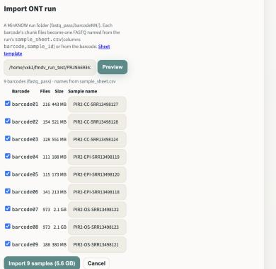
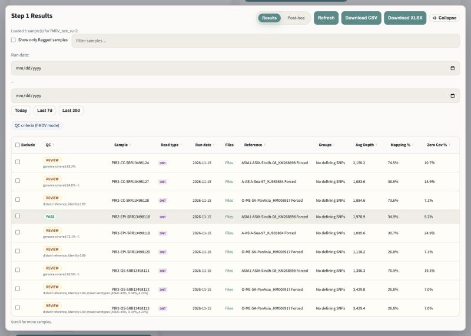

# FMDV mode walkthrough: a whole public project, end to end

Written 15 November 2026 for the staff at the Animal Health Institute in
Ethiopia who will run FMDV mode on their own NanoFMDV runs. It follows one
project from the first download to the last tree, with the numbers each
screen showed and the decision a user makes at that point.

The data is Pirbright's BioProject `PRJNA693428`, public on the NCBI
Sequence Read Archive. It stands in for an AHI run: amplicon nanopore
reads from several field-style materials, sequenced on a MinION, with no
reference chosen in advance. The project on the server is called
`FMDV_test_run2`.

Read this beside `FMDV_MODE_HANDOFF.md`, which says how to install the
pieces, and `FMDV_MODE.md`, which says why the design is what it is.

## Step 0. Know what you are about to analyse

Before anything is downloaded or run, list the runs and look at them.
`PRJNA693428` holds twelve runs over six biological samples.

| Run | Library name | Platform | Reads | Bases | Size |
|---|---|---|---|---|---|
| SRR13498127 | FMDV_A_CC_30hr | MinION | 861,428 | 390,040,040 | 442 MB |
| SRR13498128 | FMDV_O_CC_30hr | MinION | 615,523 | 475,127,788 | 520 MB |
| SRR13498124 | FMDV_ASIA1_CC_30hr | MinION | 509,793 | 509,866,675 | 551 MB |
| SRR13498119 | FMDV_A_EPI_30hr | MinION | 441,113 | 162,065,051 | 187 MB |
| SRR13498120 | FMDV_O_EPI_30hr | MinION | 456,711 | 147,952,783 | 173 MB |
| SRR13498118 | FMDV_ASIA1_EPI_30hr | MinION | 560,280 | 181,335,247 | 212 MB |
| SRR13498122 | FMDV_A_OS_30hr | MinION | 3,892,000 | 1,989,383,393 | 2,121 MB |
| SRR13498123 | FMDV_O_OS_30hr | MinION | 3,892,000 | 1,989,383,393 | 2,121 MB |
| SRR13498121 | FMDV_ASIA1_OS_30hr | MinION | 751,220 | 338,216,235 | 379 MB |
| SRR13498126 | FMDV_A_CC_MiSeq | Illumina MiSeq | 129,770 | 39,190,540 | 27 MB |
| SRR13498117 | FMDV_O_CC_MiSeq | Illumina MiSeq | 475,082 | 143,474,764 | 99 MB |
| SRR13498125 | FMDV_ASIA1_CC_MiSeq | Illumina MiSeq | 28,149 | 8,500,998 | 6 MB |

CC is cell culture, EPI is epithelium, OS is oral swab. The library names
carry the submitter's serotype label. Those labels are metadata, not
evidence. Nothing in this walkthrough treats them as the answer; they are
kept to one side and compared with the pipeline's call at the end.

**What the list already tells you.** Two of the oral swab runs,
SRR13498122 and SRR13498123, report exactly the same read count and the
same base count. The SRA run table also gives them the same RunHash and
the same ReadHash. That is a warning on the face of the metadata, before
a single read is downloaded.

**Decide here.** Nine runs are MinION and three are Illumina MiSeq. FMDV
mode's primer clipper is written for single-file long reads, so the nine
MinION runs are the ones that go through the whole pipeline. The three
MiSeq runs are used later as an independent check of the reference
chooser only, on three of the same biological samples.

**For your own run.** You will not have an SRA table. The equivalent is
the MinKNOW run summary and your own sample sheet: how many barcodes, how
many reads each, which material each barcode came from. Write that down
before you start, because every later surprise is read against it.

## Step 1. Get the reads onto the server

The nine MinION runs were fetched on the analysis server, not on a laptop.
Each run became one FASTQ file.

```bash
prefetch -O sra --max-size 100G SRR13498127
fasterq-dump --concatenate-reads --threads 8 --outdir fastq sra/SRR13498127
gzip -1 fastq/SRR13498127.fastq
```

All twelve runs downloaded with no failures in about four minutes. Every
file was then counted against the read count SRA publishes.

| Check | Result |
|---|---|
| Runs requested | 12 |
| Runs downloaded | 12 |
| Read counts equal to the SRA spot counts | 12 of 12 |

**Decide here.** Do not go on until the counts match. A truncated FASTQ
produces a thin consensus that looks like a bad sample rather than a bad
download, and you will spend an afternoon blaming the virus.

**The duplicate, confirmed.** The two oral swab runs flagged in Step 0
were compared directly. Their read names differ, because the names carry
the accession. Their sequences do not.

```
SRR13498122 sequence-only md5  d6a80413a14cd9ecf93f993d33a28177
SRR13498123 sequence-only md5  d6a80413a14cd9ecf93f993d33a28177
```

The two runs hold the same reads. They are submitted under different
serotype labels, A oral swab and O oral swab. Both labels cannot describe
the same reads. Which label is wrong is not something the read data can
settle, and this walkthrough does not guess. Both runs are kept and run,
exactly as received, so you can see what the pipeline says about them.

**For your own run.** The same check applies to barcodes. Two barcodes
that produce identical read counts are nearly always one library loaded
twice or a demultiplexing mistake, not two samples.

## Step 2. Make a run folder the GUI can import

The GUI takes one FASTQ per sample. MinKNOW writes the opposite shape, so
the nine FASTQs were put back into that shape: a run folder holding
`fastq_pass/barcodeNN/` with the reads split into chunks, plus a
`sample_sheet.csv` of two columns.

```
barcode,sample_id
barcode01,PIR2-CC-SRR13498127
barcode02,PIR2-CC-SRR13498128
...
```

**Sample names matter more than they look.** vsnp3 takes everything
before the first underscore of a read file as the sample name. A name with
an underscore in it silently merges samples. The importer turns
underscores into dashes for you, but it is better to write dashes in the
sheet.

**The names here carry no serotype.** Each sample is named for its
material and its run accession, `PIR2-CC-SRR13498127` and so on. The
submitter's serotype labels were deliberately left out of the names, so
that nothing on the screen suggests an answer before the chooser gives
one. For your own samples use your field or laboratory number, not a
guess at the type.

### What the screen shows

On the Inputs page, Import ONT run, type the run folder path and press
Preview.



The preview lists every barcode it found, the number of chunk files, the
total size and the sample name the sheet proposes. Nine barcodes, 6.6 GB,
and `unclassified` left out. Press Import and the nine FASTQs appear in
the project's `download/` folder, ready for Step 1. The import took about
a minute; no read is decompressed, the chunks are joined as they are.

**Decide here.** Read the proposed sample names before you press Import.
This is the last easy moment to fix a name. A wrong name after Step 1
means re-running the sample.

## Step 3. Turn on FMDV mode and choose a scope

In the Step 1 pane, tick "FMDV mode: choose the lineage reference per
sample". The reference selector is replaced by a scope picker.


Three dropdowns, each with Auto: serotype, topotype or lineage, and
genome. Left on Auto the scope reads FMDV, which means the closest
lineage genome anywhere in the library of 79. The library's contents are
on the serotype menu: A has 19 lineage genomes, ASIA1 5, C 6, O 25,
SAT1 9, SAT2 9 and SAT3 6.

**Decide here.** Leave the scope on FMDV unless you have a reason not to.
Narrowing it to a serotype tells the pipeline an answer instead of asking
for one, and a narrowed scope cannot report a surprise. The one honest
use of a narrow scope is a repeat run where the broad scope has already
given its answer and you want every sample on one reference.

Also tick "Nanopore (ONT) reads". The importer does not tick it for you.
Then press Grab ready-to-run samples, which stages the nine FASTQs, and
press Run.

## Step 4. The reference chooser, sample by sample

This is the part of FMDV mode that does not exist in stock vsnp3, and it
is the part worth understanding. Before any alignment, each sample's first
20,000 reads are mapped against the VP1 sequences of all 79 lineage
genomes. The lineage whose VP1 collects the most aligned bases names the
reference. The whole run took about three seconds per sample.

The result is written to `step1/<sample>/fmdv_reference.json`.

| Sample | Lineage chosen | f_match | Identity | Serotype shares on VP1 | Runner-up | Distant | Mixed |
|---|---|---|---|---|---|---|---|
| PIR2-CC-SRR13498124 | ASIA1-ASIA-Sindh-08_KM268898 | 0.998 | 0.907 | ASIA1 99.8% | O-ME-SA-PanAsia 0.001 | no | no |
| PIR2-CC-SRR13498127 | A-ASIA-Sea-97_KJ933864 | 0.961 | 0.864 | A 97.3%, ASIA1 1.7%, O 1.1% | ASIA1-ASIA-Sindh-08 0.015 | yes | no |
| PIR2-CC-SRR13498128 | O-ME-SA-PanAsia_HM008917 | 0.968 | 0.890 | O 99.5% | O-ME-SA-PanAsia-2 0.018 | yes | no |
| PIR2-EPI-SRR13498118 | ASIA1-ASIA-Sindh-08_KM268898 | 0.942 | 0.909 | ASIA1 97.0%, A 1.6%, O 1.4% | A-ASIA-Sea-97 0.030 | no | no |
| PIR2-EPI-SRR13498119 | A-ASIA-Sea-97_KJ933864 | 0.904 | 0.864 | A 89.4%, O 5.4%, ASIA1 5.2% | O-ME-SA-PanAsia 0.048 | yes | yes |
| PIR2-EPI-SRR13498120 | O-ME-SA-PanAsia_HM008917 | 0.908 | 0.889 | O 93.3%, ASIA1 4.3%, A 2.4% | A-ASIA-Sea-97 0.029 | yes | no |
| PIR2-OS-SRR13498121 | ASIA1-ASIA-Sindh-08_KM268898 | 0.794 | 0.912 | ASIA1 80.8%, O 14.1%, A 5.1% | O-ME-SA-PanAsia 0.137 | no | yes |
| PIR2-OS-SRR13498122 | O-ME-SA-PanAsia_HM008917 | 0.400 | 0.890 | ASIA1 43.5%, O 34.0%, A 22.5% | ASIA1-ASIA-Sindh-08 0.303 | yes | yes |
| PIR2-OS-SRR13498123 | O-ME-SA-PanAsia_HM008917 | 0.400 | 0.890 | ASIA1 43.5%, O 33.9%, A 22.6% | ASIA1-ASIA-Sindh-08 0.304 | yes | yes |

Read the columns like this. `f_match` is the winning lineage's share of
all the aligned bases, so it says how decisive the vote was. `Identity`
is how close the reads sit to the genome they were given. The serotype
shares say what else is in the tube. `Distant` is raised when identity
falls below 0.90, `mixed` when a second serotype holds more than 5% of the
FMDV reads. Neither flag stops a sample running; both ask for a look.

### What a user should conclude, sample by sample

**The three cell culture samples (124, 127, 128) and two of the three
epithelium samples (118, 120).** The vote is decisive, 0.90 to 0.998, and
one serotype holds 93% or more. These are clean single-serotype
preparations. Nothing to do but go on. The 1 to 5% of other serotypes is
barcode crosstalk, which is normal on a MinION run that carries several
serotypes on one flow cell.

**PIR2-EPI-SRR13498119.** The vote still names one lineage at 0.904, but
the other two serotypes hold 5.4% and 5.2%, so `mixed` is raised. With
three serotypes on one flow cell and two of them just over the 5% line,
crosstalk is the explanation to prefer. Go on, and when the tree is drawn
check that this sample sits with its own serotype and not between two.

**PIR2-OS-SRR13498121.** The oral swab. ASIA1 still wins clearly at 80.8%,
but O is at 14.1%, well above crosstalk from the same run. A swab picks up
whatever is in the mouth, and an animal can carry more than one serotype.
Go on with the ASIA1 reference, and treat the O reads as a question for
the tree and for a second pass on an O reference, not as noise.

**PIR2-OS-SRR13498122 and PIR2-OS-SRR13498123.** These are the two runs
holding identical reads. The pipeline gave them identical numbers, which
is the first confirmation that the chooser is deterministic. The numbers
themselves say the material is a three-way mixture: ASIA1 43.5%, O 34.0%,
A 22.5% of the FMDV reads. The winning vote is only 0.400.

**Here the chooser's two numbers point different ways, and you must know
why.** The serotype shares above are counted in reads. The vote is counted
in aligned bases. ASIA1 contributed more reads, O contributed more aligned
bases, so the composition line reads ASIA1 first while the reference
chosen is O. Both numbers are correct and they are measuring different
things. Aligned bases is the better statistic for choosing a reference,
because a read that aligns over 400 bases is better evidence than a read
that aligns over 90. But a user reading the file from the top will see
ASIA1 at the head of the composition and O as the choice, and will be
confused. This is written up as a finding below.

**What to do with a sample like this.** Do not accept either reference as
the sample's type. A 0.40 vote on a three-way mixture is the pipeline
telling you that one consensus genome cannot describe this tube. Run it,
look at the depth and the consensus, and expect a patchy genome. Then go
back to the bench: re-extract, or sequence the swab again with one
serotype's primers, or accept it as a mixture and report it as one.

### An independent check from a second platform

Three of these biological samples were also sequenced on an Illumina
MiSeq, and those runs were put through the chooser on their own.

| Sample | MinION run and call | Identity | MiSeq run and call | Identity |
|---|---|---|---|---|
| A cell culture | SRR13498127, A-ASIA/Sea-97 | 0.864 | SRR13498126, A-ASIA/Sea-97 | 0.937 |
| O cell culture | SRR13498128, O-ME-SA/PanAsia | 0.890 | SRR13498117, O-ME-SA/PanAsia | 0.959 |
| ASIA1 cell culture | SRR13498124, ASIA1-ASIA/Sindh-08 | 0.907 | SRR13498125, ASIA1-ASIA/Sindh-08 | 0.977 |

The chooser lands on the same lineage from both platforms for all three.
That is as good a confirmation as this data can give, because the two read
sets come from the same material through different chemistry.

**It also shows what the distant flag really measures.** The A cell
culture sample is flagged distant at 0.864 on nanopore and not flagged at
0.937 on Illumina. It is the same virus and the same genetic distance.
The difference is nanopore read error. So a `distant` flag on nanopore
reads is partly divergence and partly error rate, and should not be read
as a statement about how far the virus is from the reference. The honest
reading is "this consensus will need checking", not "this is a novel
lineage".

## Step 5. The first run failed, and what that looks like

The first attempt at Step 1 failed on all nine samples. This is in the
walkthrough on purpose, because it is the failure a new site is most
likely to hit, and because it shows what the GUI does when a sample
fails.

Each sample turned red in the Samples list with the words "Failed during
Step 1 — open View log for the error". The log said:

```
File "/home/vxk1/vsnp3/bin/vsnp3_file_setup.py", line 13, in <module>
    import svgwrite
ModuleNotFoundError: No module named 'svgwrite'
```

The chooser and the primer clipper had already run and succeeded. vsnp3
itself could not start, because the Python interpreter that was first on
the server's path did not carry one of vsnp3's dependencies.

**What the user does.** Nothing in the project is wrong, so nothing in
the project needs rebuilding. Fix the environment, tick "Force re-run"
and press Run again. The chooser runs again and gives the same answer,
which is itself worth seeing.

**What to check before you start.** The backend must be started with an
environment in which `vsnp3_step1.py` runs. On this server that means the
conda `vsnp3` environment comes first on the path. Test it in a terminal
before you start the server:

```bash
vsnp3_step1.py --help
```

If that prints the usage text, Step 1 will run. If it raises
`ModuleNotFoundError`, fix it there, not in the GUI. The GUI has no
setting for which Python runs vsnp3; it inherits the path of the process
that started it.

**A note for whoever installs this.** The vSNP3 path in Settings points
at the folder holding the vsnp3 scripts. It does not select the
interpreter those scripts run under. Those are two different things and
only one of them is visible in the interface.

## Step 6. Step 1 ran: primer clipping, alignment and consensus

With the environment fixed the nine samples ran. Seven finished in 41 to
123 seconds each; the two 3.9 million read oral swab samples took longer.
Eight ran at once, which is the Max parallel setting.

### Primer clipping

The clipper finds each primer's best binding site on the reference the
chooser picked, then removes the primer-derived bases from the ends of
every read. It is done per sample because the tiled scheme binds
differently on every lineage.

Nearly every read survives. On SRR13498122, 3,892,000 reads went in and
3,891,829 came out, with 27 of the 33 primers placed and 6 left out
because their best fit on this reference fell below 0.8.

**Read the "below fit" number.** A primer left out is a primer that does
not bind this lineage well enough to trust its coordinates. Leaving it out
is the safe choice: an unconditional clip would cut a random stretch of
genome. But it also means those amplicon ends keep their primer bases, and
any variant under them reads as the primer, not as the virus. Six of 33 is
normal for a strain this far from the library genome. If you see most of
the primers below fit, the reference is wrong for the sample, not the
other way round.

### The consensus

The consensus is built from vsnp3's own calls with a pileup check, and any
position with fewer than ten reads becomes N. The numbers go to
`step1/<sample>/fmdv_consensus.json` and the FASTA sits beside it.

| Sample | Reference | Genome called | Substitutions | VP1 called |
|---|---|---|---|---|
| PIR2-CC-SRR13498124 | ASIA1-ASIA-Sindh-08 | 42.4% | 79 | 100.0% |
| PIR2-CC-SRR13498127 | A-ASIA-Sea-97 | 54.1% | 322 | 99.8% |
| PIR2-CC-SRR13498128 | O-ME-SA-PanAsia | 56.0% | 179 | 99.8% |
| PIR2-EPI-SRR13498118 | ASIA1-ASIA-Sindh-08 | 63.2% | 111 | 99.7% |
| PIR2-EPI-SRR13498119 | A-ASIA-Sea-97 | 46.9% | 237 | 99.2% |
| PIR2-EPI-SRR13498120 | O-ME-SA-PanAsia | 62.4% | 191 | 99.8% |
| PIR2-OS-SRR13498121 | ASIA1-ASIA-Sindh-08 | 65.4% | 112 | 99.7% |

**This table is the single most useful thing on the page, and it is easy
to misread.** The genome column says 42 to 65% called. The VP1 column says
99.2 to 100% called, in every sample. Those are not in conflict and the
difference is the point of the design.

VP1 is the capsid region that defines serotype and topotype. The reference
was chosen by matching the sample's VP1 against 79 lineages, so by
construction the sample sits close to its reference across the capsid, and
the reads map there at full depth. Elsewhere in the genome, especially in
the non-structural half, FMDV recombines: a serotype A field strain's 3'
end can be closer to some other serotype's genome than to the A genome in
the library. Reads from those regions do not map well to the chosen
reference, depth falls below ten, and the consensus is masked to N.

**What a user should conclude.** A genome called at 50% with VP1 called at
100% is a usable result for typing and for a VP1 tree. It is not a
complete genome and should not be submitted as one. If you need the whole
genome, this reference library of one genome per lineage is not enough;
you need a closer genome, which is what the two-level mapping idea in
`FMDV_MODE.md` is for and which is not built.

**And it is a check on the reference.** If VP1 came out at 60% called
while the rest of the genome was high, the chooser would have given the
sample the wrong capsid, and the typing would be worth nothing. Look at
the VP1 column first.

## Step 7. Read the QC verdict

Press Refresh in Step 1 Results and the table fills.



In FMDV mode the verdict uses FMDV thresholds, not the bacterial-isolate
ones. The link "QC criteria (FMDV mode)" above the table shows them. For
this project they are: genome covered 90% to pass and 70% to review,
average depth 100 to pass and 20 to review, mapping rate 20% to pass, and
the two FMDV signals, a distant reference and a mixed sample, which raise
review and never fail.

| Sample | Verdict | Genome covered | Average depth | Mapping | Quality SNPs | Reason given |
|---|---|---|---|---|---|---|
| PIR2-CC-SRR13498124 | review | 89.3% | 2,150 | 74.5% | 79 | genome covered under 90% |
| PIR2-CC-SRR13498127 | review | 84.1% | 1,684 | 36.9% | 326 | genome covered under 90%, distant reference 0.86 |
| PIR2-CC-SRR13498128 | review | 92.9% | 1,885 | 73.6% | 180 | distant reference 0.89 |
| PIR2-EPI-SRR13498118 | **pass** | 90.8% | 1,979 | 34.9% | 114 | none |
| PIR2-EPI-SRR13498119 | review | 75.1% | 1,096 | 30.7% | 264 | genome covered under 90%, distant 0.86, mixed |
| PIR2-EPI-SRR13498120 | review | 92.9% | 1,118 | 26.8% | 202 | distant reference 0.89 |
| PIR2-OS-SRR13498121 | review | 80.5% | 1,396 | 76.9% | 117 | genome covered under 90%, mixed |
| PIR2-OS-SRR13498122 | review | 93.0% | 3,430 | 26.8% | 323 | distant 0.89, mixed |
| PIR2-OS-SRR13498123 | review | 93.0% | 3,430 | 26.8% | 323 | distant 0.89, mixed |

One pass, eight review, no failures. That is the right answer for this
project and it is worth saying why.

**Review is not a problem.** It means a human should look. Every reason
given here is true and each one names something real: a strain far from
the nearest library genome, or more than one serotype in the tube. None of
them says the run failed. A site that treats review as failure will throw
away most of its outbreak samples.

**Two different coverage numbers, and they do not agree.** The table says
"genome covered" 75 to 93%. The consensus file says 42 to 84% called. The
first counts positions with at least one read. The second counts positions
with at least ten, which is the depth the consensus needs before it will
call a base. A sample can be 93% covered and 56% called. When you report
coverage, say which one you mean.

**Depth is not the limiting factor here.** Average depth runs from 1,100
to 3,400, which is a hundred times the threshold. Nothing about these
samples is short of reads. What limits them is that the virus is 10 to 14%
away from the nearest genome in a library of 79.

**Mapping rate of 27 to 77% is normal for a swab or an epithelium
sample.** The rest of the reads are host, bacteria and whatever else was
on the swab. The FMDV pass threshold is 20% for this reason. The stock
bacterial threshold of 90% would fail every sample in this project.

**What a user does next.** Take the one that passed and the ones whose
only reason is a distant reference, and go to Step 2. Treat the two
oral swab samples flagged mixed at 43/34/23 as unresolved, and look at
them again on the tree before reporting anything about them.

## Step 8. The VP1 tree: where each sample sits among known viruses

The VP1 tree is the view a reference laboratory would recognise. FMDV
serotypes, topotypes and lineages are defined on VP1, and recombination,
which is almost all in the non-structural half of the genome, does not
reach it. A whole-genome tree built on one reference would put samples of
different serotypes in no clade at all.

It is a command, not a button:

```bash
python bin/fmdv_vp1_tree.py --project ~/projects/FMDV_test_run2 --lib ~/fmdv_refs --serotype ASIA1
```

The tree holds the project's samples of that serotype, the library's
lineage panel, and a selection from the GenBank context set. The selection
is made on genetics, never on geography: identical sequences collapse to
one, a backbone of up to twenty per topotype is chosen to span each
topotype's genetic range, and each sample's twenty nearest sequences are
added. `VP1_context_selection.tsv` in the output says why each sequence is
there. The output folder appears in the Step 2 run list and opens in the
tree viewer.

### ASIA1: three materials, one virus

The ASIA1 tree took about three minutes: 3 samples, 111 other sequences
from a context set of 678 records that collapsed to 626 distinct ones.

The three samples the chooser called ASIA1 sit at a patristic distance of
zero from each other, and at zero from two GenBank sequences of the
ASIA1/ASIA/Sindh-08 lineage, `KU365789` and `OM471664.1`. The next nearest
sequences, two more Sindh-08 records, sit at 0.0016.

| Sample | Material | Nearest neighbours at distance 0 |
|---|---|---|
| PIR2-CC-SRR13498124 | cell culture | the other two samples, ASIA1-ASIA-SINDH-08_KU365789, ASIA1-NA_OM471664.1 |
| PIR2-EPI-SRR13498118 | epithelium | the other two samples, the same two GenBank records |
| PIR2-OS-SRR13498121 | oral swab | the other two samples, the same two GenBank records |

**What a user should conclude.** Cell culture, epithelium and oral swab
from this experiment carry the same VP1, and that VP1 belongs with
Sindh-08 sequences in GenBank. Three different materials giving one answer
is the strongest internal check this data offers: it says the result is a
property of the virus, not of the preparation.

**The oral swab is the interesting one.** Its chooser output was flagged
mixed, with O holding 14% of its FMDV reads. On the tree its VP1 lands
exactly where the two clean samples land. The 14% did not move the
consensus. That is what you want to see, and it is only visible because
the tree was drawn.

**What a user should not conclude.** A distance of zero on VP1 is not
proof that two samples are the same virus. VP1 is about 630 nucleotides.
The SNP distances from Step 2 use the whole mapped genome and are the
place to look for differences between samples that share a VP1.

## Step 9. Step 2: comparing samples on one reference

Step 2 is stock vsnp3. It takes a folder of VCFs called on one reference
and builds the SNP matrix and the trees. FMDV mode changes one thing: the
project's samples are on three different references, so Step 2 runs once
per reference.

The samples split like this:

| Reference | Samples |
|---|---|
| ASIA1-ASIA-Sindh-08_KM268898 | PIR2-CC-SRR13498124, PIR2-EPI-SRR13498118, PIR2-OS-SRR13498121 |
| A-ASIA-Sea-97_KJ933864 | PIR2-CC-SRR13498127, PIR2-EPI-SRR13498119 |
| O-ME-SA-PanAsia_HM008917 | PIR2-CC-SRR13498128, PIR2-EPI-SRR13498120, PIR2-OS-SRR13498122, PIR2-OS-SRR13498123 |

**Decide here, and understand the limit.** Samples on different references
cannot be compared with each other. There is no SNP distance between the
ASIA1 sample and the O sample, and there should not be: they do not share
a coordinate system. The tree that relates them is the VP1 tree. The SNP
matrix relates samples that sit on the same reference.

### Building the databases for a reference

The trials before this one had built Step 2 databases for one SAT1
reference only. These three had to be made, which is three commands per
reference and about twenty minutes for all three:

```bash
bash bin/fmdv_panel_build.sh ASIA1-ASIA-Sindh-08_KM268898
python bin/fmdv_panel_register.py ASIA1-ASIA-Sindh-08_KM268898
python bin/fmdv_genome_db.py --source <collection> --lib ~/fmdv_refs --ref ASIA1-ASIA-Sindh-08_KM268898 --register
python bin/fmdv_define_snps.py --lib ~/fmdv_refs --ref ASIA1-ASIA-Sindh-08_KM268898
```

That gives three databases for the ASIA1 reference: the 78 other lineage
genomes (`FMDV_all`), the 4 other ASIA1 lineage genomes (`ASIA1`), and the
131 complete ASIA1 genomes GenBank holds (`ASIA1_genbank`). For A it is
78, 18 and 299; for O it is 78, 24 and 896.

### What the screen shows


Pick the comparison reference at the top. The select lists only the
references this project's samples landed on, with the count: "A-ASIA-Sea-97
(2 samples)", "ASIA1-ASIA-Sindh-08 (3 samples)", "O-ME-SA-PanAsia (4
samples)". Choosing one unticks the samples on the other references, so
the build list holds just the three you are comparing.

Box 2 then lists the databases built for that reference. Tick the
serotype's own database and the GenBank one. Leave `FMDV_all` unticked:
across serotypes only the recombining half of the genome aligns, so a tree
containing all of them says nothing about serotype.

Then Build, which copies the ticked VCFs into `step2/vcf_database`, and
Run.

**Check the count after Build.** The line under the Build button says what
went in, for example "vcf_database: 9 | ASIA1_genbank: 131 | ASIA1: 4", and
the line beside Run says "This run compares 138 of the 144 VCFs in the set
(6 excluded in the sample list)". On this run the first press of Build
collected only the 9 project samples, because the tick had not reached the
server yet. Pressing Build again picked up all 144. Build only ever adds
files, so pressing it twice is safe, and the count is the thing to read
before pressing Run.

### Three things went wrong, and all three matter for your site

Step 2 failed three times before it ran. None of the failures was in the
data. All three are worth knowing about because you will meet them.

**One: no single Python had everything vsnp3 needs.** The server has two
vsnp3 installations. One has the `svgwrite` module that Step 1 imports and
not the `plotly` module that Step 2 imports; the other has plotly and not
svgwrite. Step 1 ran under one and Step 2 died instantly under it. The fix
was to install plotly into the environment that runs the GUI. Before you
start, check both steps from a terminal in the environment you will start
the server in.

**Two: the version of pandas was too new for vsnp3.** With pandas 3,
vsnp3 raised `KeyError: 0` while building its SNP table and the run died
after it had built the trees. With pandas 2.3 it runs. This is a vsnp3
limit, not an FMDV one, and it will bite any vsnp3 installation that gets
a fresh conda environment.

**Three: FMDV topotype names contain slashes, and vsnp3 uses a group name
as a folder name.** The defining-SNP groups derived for the ASIA1
reference were called `ASIA1-ASIA/G-IX` and `ASIA1-ASIA/SINDH-08`. vsnp3
tried to write `ASIA1-ASIA/G-IX/ASIA1-ASIA/G-IX-<date>.fasta` into a
folder that does not exist, and the whole run was lost after the trees had
been built. The SAT1 trials never saw this because SAT1 topotypes are
roman numerals with no slash in them. This was a fault in our own code and
it is fixed: group names now use dashes.

**A fourth thing is not a fault but will stop you.** With only three
samples and small groups, vsnp3 builds no tree at all unless you ask for
the all-samples table, and then it crashes on a missing attribute while
writing its summary. Tick **All VCF table (-a)** under Step 2 Options.
That is the option that produces the tree holding every sample in the
comparison, which is the tree you want anyway.

### Switching reference: clear the set first

The comparison set folder is permanent and only ever grows. After the
ASIA1 run it held 144 VCFs. Choosing the A reference and pressing Build
added the A databases on top, giving 461, and the GUI refused to run:

```
Run is disabled: 135 VCFs in the comparison set were called against a
different reference — fix them in Reference check below.
```

That refusal is correct and it saved the run. Use **Clear comparison set**
under More options, then Build again. The set came back at 319 VCFs, the
two A samples with 18 A lineage genomes and 299 GenBank A genomes, and the
Run line read "This run compares 319 of the 319 VCFs in the set — ready to
Run".

**For your own run.** One reference at a time, and clear the set between
references. Read the Run line before you press it. If it says a number you
do not expect, something is in the folder that you did not put there.

### What the ASIA1 comparison says

The ASIA1 run compared 3 samples against 135 reference genomes and
finished in 32 seconds. The all-samples tree put the three together, and
their nearest known relatives are the same GenBank genomes the VP1 tree
chose, `OM471664`, `OM471665` and `OM471676`.

The SNP distances, counted over the 3,170 variable positions of the
comparison and ignoring any position masked in either sequence:

|  | CC-124 | EPI-118 | OS-121 | OM471665 |
|---|---|---|---|---|
| CC-SRR13498124 | 0 | 26 | 33 | 55 |
| EPI-SRR13498118 | 26 | 0 | 10 | 35 |
| OS-SRR13498121 | 33 | 10 | 0 | 20 |
| ASIA1-NA_OM471665 | 55 | 35 | 20 | 0 |

**Read this against the VP1 tree, because the two say different things.**
On VP1 the three samples were identical. On the whole mapped genome they
differ by 10 to 33 SNPs. Both are true: VP1 is 630 nucleotides and the
comparison here uses several thousand variable positions across the
genome.

**Be careful about what those SNPs mean.** Nanopore reads sit 10 to 14%
from this reference, the consensus calls only half the genome, and
differences of this size can come from sequencing error as easily as from
the virus. A difference of 10 SNPs between an epithelium sample and an
oral swab of the same animal is not evidence of two viruses. What this
table does establish is an upper bound: nothing here is a different
lineage, and the three samples are closer to each other than any of them
is to the nearest GenBank genome.

**For your own run.** Use the SNP matrix to answer "are these two samples
the same outbreak", not "are these two samples the same virus". For the
second question you need a closer reference and a genome called at more
than half its length.

### What the A comparison says

The A reference run compared the two A samples against 317 reference
genomes and finished in under a minute. On VP1 the two samples sit at
0.0015 from each other, their nearest GenBank sequence is `LC564922.1`,
and the lineage genome the chooser picked, `A-ASIA/SEA-97 KF450794`, is
close behind them.

That is the shape you want: the two samples together, their own lineage
around them, and nothing from another serotype between them and it.

## Step 10. What this run adds to what was already known

The November trials ran six of these samples, the cell culture and
epithelium ones. This run added the three oral swabs, three Illumina runs
of the same cell cultures, and the whole Step 2 and tree path on three
references instead of one. Here is what held and what is new.

**The chooser's calls held, exactly.** All six repeats gave the same
serotype and the same lineage as before. The three new oral swabs gave
answers consistent with the material they came from.

**The read fraction and the crosstalk, measured on the first 20,000 reads
of each sample:**

| Sample | FMDV reads | Second serotype present |
|---|---|---|
| PIR2-CC-SRR13498124 | 69.3% | 0.2% |
| PIR2-CC-SRR13498127 | 23.5% | 2.7% |
| PIR2-CC-SRR13498128 | 67.4% | 0.5% |
| PIR2-EPI-SRR13498118 | 32.8% | 3.0% |
| PIR2-EPI-SRR13498119 | 23.1% | 10.6% |
| PIR2-EPI-SRR13498120 | 24.9% | 6.7% |
| PIR2-OS-SRR13498121 | 73.7% | 19.2% |
| PIR2-OS-SRR13498122 | 36.4% | 56.5% |
| PIR2-OS-SRR13498123 | 36.4% | 56.5% |

The cell culture and epithelium samples sit where the earlier work put
them, with crosstalk from 0.2% to 10.6%. The oral swabs are different:
19.2% and 56.5% of their FMDV reads come from a serotype other than the
winner. **That is the main thing this run adds.** An oral swab is not a
cleaner or a dirtier version of an epithelium sample; it is a different
kind of sample, and the pipeline's mixed flag earns its place on it.

**The identity numbers are lower than the earlier summary suggests, and
the reason matters.** Read identity to the chosen reference runs from
0.864 to 0.912 on nanopore. The Illumina runs of three of the same
samples gave 0.937 to 0.977 on the same references. The virus did not
move. Roughly five to seven points of that gap is nanopore read error.
So a statement like "these strains are 15% from the nearest library
genome" should not be read off nanopore read identity; the genetic
distance is smaller than the read identity suggests.

**One sample pair is not two samples.** SRR13498122 and SRR13498123 are
submitted as different serotypes and hold identical reads. Every number
the pipeline produced for them matches to the last digit: the same
lineage, f_match 0.3998 and 0.3999, 84.45% of the genome called, 250
substitutions, 164 ambiguous positions, 14 pileup overrides. That is a
useful demonstration that the pipeline is deterministic, and it is a
warning about trusting a submitted label.

**What the chooser says about that pair, carefully.** Their FMDV reads
are 43.5% ASIA1, 34.0% O and 22.5% A by read count, and by aligned bases
O leads at 41.0%. The pipeline picked the O lineage because the vote goes
by aligned bases. It would be wrong to report these as O samples. They are
a mixture in which no serotype holds a majority, and the honest conclusion
is that this material cannot be typed from these reads.

### The O VP1 tree, and a trap in it

The O tree is the big one: a context set of 4,930 GenBank VP1 sequences
that collapsed to 4,508 distinct ones, from which 574 backbone and 20
neighbour sequences were chosen, giving 619 sequences beside the 4
samples. It took about twelve minutes.

All four O samples sit at a patristic distance of zero from each other and
from O/ME-SA/PanAsia GenBank sequences `KJ831678`, `FJ542371` and
`AJ311723`.

**Here is the trap, and it is the most important thing in this
walkthrough.** Two of those four samples are the oral swab pair whose
reads are 43% ASIA1, 34% O and 23% A. On the VP1 tree they look like
clean O/ME-SA/PanAsia samples, indistinguishable from the cell culture and
the epithelium sample. The tree cannot show the mixture, because the
consensus takes the majority base at each position and O had the plurality.
A reviewer who looked only at this tree would report two more PanAsia
samples and be wrong.

**What protects you is the chooser's output, not the tree.** The mixed
flag, the serotype shares and the low `f_match` of 0.40 are the only
places the mixture appears. So the order of reading matters:

1. `fmdv_reference.json` and the QC verdict first. Is this sample one
   virus?
2. The consensus numbers. Is there enough of it to say anything?
3. The tree and the SNP matrix last. Where does it sit?

A tree is a picture of a consensus sequence. If the consensus is a
majority vote over a mixture, the picture is of something that was never
in the animal.
