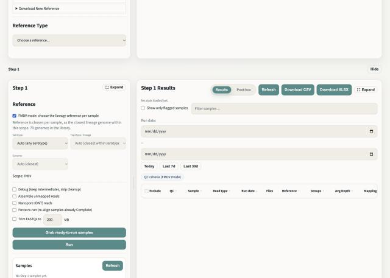

# FMDV mode walkthrough: a whole public project, end to end

Written 15 November 2026 for the staff at the Animal Health Institute in
Ethiopia who will run FMDV mode on their own NanoFMDV runs. It follows one
project from the first download to the last tree, with the numbers each
screen showed and the decision a user makes at that point.

The data is Pirbright's BioProject `PRJNA693428`, public on the NCBI
Sequence Read Archive. It stands in for an AHI run: amplicon nanopore
reads from several field-style materials, sequenced on a MinION, with no
reference chosen in advance. The project on the server is called
`FMDV_test_run2`.

Read this beside `FMDV_MODE_HANDOFF.md`, which says how to install the
pieces, and `FMDV_MODE.md`, which says why the design is what it is.

## Step 0. Know what you are about to analyse

Before anything is downloaded or run, list the runs and look at them.
`PRJNA693428` holds twelve runs over six biological samples.

| Run | Library name | Platform | Reads | Bases | Size |
|---|---|---|---|---|---|
| SRR13498127 | FMDV_A_CC_30hr | MinION | 861,428 | 390,040,040 | 442 MB |
| SRR13498128 | FMDV_O_CC_30hr | MinION | 615,523 | 475,127,788 | 520 MB |
| SRR13498124 | FMDV_ASIA1_CC_30hr | MinION | 509,793 | 509,866,675 | 551 MB |
| SRR13498119 | FMDV_A_EPI_30hr | MinION | 441,113 | 162,065,051 | 187 MB |
| SRR13498120 | FMDV_O_EPI_30hr | MinION | 456,711 | 147,952,783 | 173 MB |
| SRR13498118 | FMDV_ASIA1_EPI_30hr | MinION | 560,280 | 181,335,247 | 212 MB |
| SRR13498122 | FMDV_A_OS_30hr | MinION | 3,892,000 | 1,989,383,393 | 2,121 MB |
| SRR13498123 | FMDV_O_OS_30hr | MinION | 3,892,000 | 1,989,383,393 | 2,121 MB |
| SRR13498121 | FMDV_ASIA1_OS_30hr | MinION | 751,220 | 338,216,235 | 379 MB |
| SRR13498126 | FMDV_A_CC_MiSeq | Illumina MiSeq | 129,770 | 39,190,540 | 27 MB |
| SRR13498117 | FMDV_O_CC_MiSeq | Illumina MiSeq | 475,082 | 143,474,764 | 99 MB |
| SRR13498125 | FMDV_ASIA1_CC_MiSeq | Illumina MiSeq | 28,149 | 8,500,998 | 6 MB |

CC is cell culture, EPI is epithelium, OS is oral swab. The library names
carry the submitter's serotype label. Those labels are metadata, not
evidence. Nothing in this walkthrough treats them as the answer; they are
kept to one side and compared with the pipeline's call at the end.

**What the list already tells you.** Two of the oral swab runs,
SRR13498122 and SRR13498123, report exactly the same read count and the
same base count. The SRA run table also gives them the same RunHash and
the same ReadHash. That is a warning on the face of the metadata, before
a single read is downloaded.

**Decide here.** Nine runs are MinION and three are Illumina MiSeq. FMDV
mode's primer clipper is written for single-file long reads, so the nine
MinION runs are the ones that go through the whole pipeline. The three
MiSeq runs are used later as an independent check of the reference
chooser only, on three of the same biological samples.

**For your own run.** You will not have an SRA table. The equivalent is
the MinKNOW run summary and your own sample sheet: how many barcodes, how
many reads each, which material each barcode came from. Write that down
before you start, because every later surprise is read against it.

## Step 1. Get the reads onto the server

The nine MinION runs were fetched on the analysis server, not on a laptop.
Each run became one FASTQ file.

```bash
prefetch -O sra --max-size 100G SRR13498127
fasterq-dump --concatenate-reads --threads 8 --outdir fastq sra/SRR13498127
gzip -1 fastq/SRR13498127.fastq
```

All twelve runs downloaded with no failures in about four minutes. Every
file was then counted against the read count SRA publishes.

| Check | Result |
|---|---|
| Runs requested | 12 |
| Runs downloaded | 12 |
| Read counts equal to the SRA spot counts | 12 of 12 |

**Decide here.** Do not go on until the counts match. A truncated FASTQ
produces a thin consensus that looks like a bad sample rather than a bad
download, and you will spend an afternoon blaming the virus.

**The duplicate, confirmed.** The two oral swab runs flagged in Step 0
were compared directly. Their read names differ, because the names carry
the accession. Their sequences do not.

```
SRR13498122 sequence-only md5  d6a80413a14cd9ecf93f993d33a28177
SRR13498123 sequence-only md5  d6a80413a14cd9ecf93f993d33a28177
```

The two runs hold the same reads. They are submitted under different
serotype labels, A oral swab and O oral swab. Both labels cannot describe
the same reads. Which label is wrong is not something the read data can
settle, and this walkthrough does not guess. Both runs are kept and run,
exactly as received, so you can see what the pipeline says about them.

**For your own run.** The same check applies to barcodes. Two barcodes
that produce identical read counts are nearly always one library loaded
twice or a demultiplexing mistake, not two samples.

## Step 2. Make a run folder the GUI can import

The GUI takes one FASTQ per sample. MinKNOW writes the opposite shape, so
the nine FASTQs were put back into that shape: a run folder holding
`fastq_pass/barcodeNN/` with the reads split into chunks, plus a
`sample_sheet.csv` of two columns.

```
barcode,sample_id
barcode01,PIR2-CC-SRR13498127
barcode02,PIR2-CC-SRR13498128
...
```

**Sample names matter more than they look.** vsnp3 takes everything
before the first underscore of a read file as the sample name. A name with
an underscore in it silently merges samples. The importer turns
underscores into dashes for you, but it is better to write dashes in the
sheet.

**The names here carry no serotype.** Each sample is named for its
material and its run accession, `PIR2-CC-SRR13498127` and so on. The
submitter's serotype labels were deliberately left out of the names, so
that nothing on the screen suggests an answer before the chooser gives
one. For your own samples use your field or laboratory number, not a
guess at the type.

### What the screen shows

On the Inputs page, Import ONT run, type the run folder path and press
Preview.


The preview lists every barcode it found, the number of chunk files, the
total size and the sample name the sheet proposes. Nine barcodes, 6.6 GB,
and `unclassified` left out. Press Import and the nine FASTQs appear in
the project's `download/` folder, ready for Step 1. The import took about
a minute; no read is decompressed, the chunks are joined as they are.

**Decide here.** Read the proposed sample names before you press Import.
This is the last easy moment to fix a name. A wrong name after Step 1
means re-running the sample.

## Step 3. Turn on FMDV mode and choose a scope

In the Step 1 pane, tick "FMDV mode: choose the lineage reference per
sample". The reference selector is replaced by a scope picker.



Three dropdowns, each with Auto: serotype, topotype or lineage, and
genome. Left on Auto the scope reads FMDV, which means the closest
lineage genome anywhere in the library of 79. The library's contents are
on the serotype menu: A has 19 lineage genomes, ASIA1 5, C 6, O 25,
SAT1 9, SAT2 9 and SAT3 6.

**Decide here.** Leave the scope on FMDV unless you have a reason not to.
Narrowing it to a serotype tells the pipeline an answer instead of asking
for one, and a narrowed scope cannot report a surprise. The one honest
use of a narrow scope is a repeat run where the broad scope has already
given its answer and you want every sample on one reference.

Also tick "Nanopore (ONT) reads". The importer does not tick it for you.
Then press Grab ready-to-run samples, which stages the nine FASTQs, and
press Run.

## Step 4. The reference chooser, sample by sample

This is the part of FMDV mode that does not exist in stock vsnp3, and it
is the part worth understanding. Before any alignment, each sample's first
20,000 reads are mapped against the VP1 sequences of all 79 lineage
genomes. The lineage whose VP1 collects the most aligned bases names the
reference. The whole run took about three seconds per sample.

The result is written to `step1/<sample>/fmdv_reference.json`.

| Sample | Lineage chosen | f_match | Identity | Serotype shares on VP1 | Runner-up | Distant | Mixed |
|---|---|---|---|---|---|---|---|
| PIR2-CC-SRR13498124 | ASIA1-ASIA-Sindh-08_KM268898 | 0.998 | 0.907 | ASIA1 99.8% | O-ME-SA-PanAsia 0.001 | no | no |
| PIR2-CC-SRR13498127 | A-ASIA-Sea-97_KJ933864 | 0.961 | 0.864 | A 97.3%, ASIA1 1.7%, O 1.1% | ASIA1-ASIA-Sindh-08 0.015 | yes | no |
| PIR2-CC-SRR13498128 | O-ME-SA-PanAsia_HM008917 | 0.968 | 0.890 | O 99.5% | O-ME-SA-PanAsia-2 0.018 | yes | no |
| PIR2-EPI-SRR13498118 | ASIA1-ASIA-Sindh-08_KM268898 | 0.942 | 0.909 | ASIA1 97.0%, A 1.6%, O 1.4% | A-ASIA-Sea-97 0.030 | no | no |
| PIR2-EPI-SRR13498119 | A-ASIA-Sea-97_KJ933864 | 0.904 | 0.864 | A 89.4%, O 5.4%, ASIA1 5.2% | O-ME-SA-PanAsia 0.048 | yes | yes |
| PIR2-EPI-SRR13498120 | O-ME-SA-PanAsia_HM008917 | 0.908 | 0.889 | O 93.3%, ASIA1 4.3%, A 2.4% | A-ASIA-Sea-97 0.029 | yes | no |
| PIR2-OS-SRR13498121 | ASIA1-ASIA-Sindh-08_KM268898 | 0.794 | 0.912 | ASIA1 80.8%, O 14.1%, A 5.1% | O-ME-SA-PanAsia 0.137 | no | yes |
| PIR2-OS-SRR13498122 | O-ME-SA-PanAsia_HM008917 | 0.400 | 0.890 | ASIA1 43.5%, O 34.0%, A 22.5% | ASIA1-ASIA-Sindh-08 0.303 | yes | yes |
| PIR2-OS-SRR13498123 | O-ME-SA-PanAsia_HM008917 | 0.400 | 0.890 | ASIA1 43.5%, O 33.9%, A 22.6% | ASIA1-ASIA-Sindh-08 0.304 | yes | yes |

Read the columns like this. `f_match` is the winning lineage's share of
all the aligned bases, so it says how decisive the vote was. `Identity`
is how close the reads sit to the genome they were given. The serotype
shares say what else is in the tube. `Distant` is raised when identity
falls below 0.90, `mixed` when a second serotype holds more than 5% of the
FMDV reads. Neither flag stops a sample running; both ask for a look.

### What a user should conclude, sample by sample

**The three cell culture samples (124, 127, 128) and two of the three
epithelium samples (118, 120).** The vote is decisive, 0.90 to 0.998, and
one serotype holds 93% or more. These are clean single-serotype
preparations. Nothing to do but go on. The 1 to 5% of other serotypes is
barcode crosstalk, which is normal on a MinION run that carries several
serotypes on one flow cell.

**PIR2-EPI-SRR13498119.** The vote still names one lineage at 0.904, but
the other two serotypes hold 5.4% and 5.2%, so `mixed` is raised. With
three serotypes on one flow cell and two of them just over the 5% line,
crosstalk is the explanation to prefer. Go on, and when the tree is drawn
check that this sample sits with its own serotype and not between two.

**PIR2-OS-SRR13498121.** The oral swab. ASIA1 still wins clearly at 80.8%,
but O is at 14.1%, well above crosstalk from the same run. A swab picks up
whatever is in the mouth, and an animal can carry more than one serotype.
Go on with the ASIA1 reference, and treat the O reads as a question for
the tree and for a second pass on an O reference, not as noise.

**PIR2-OS-SRR13498122 and PIR2-OS-SRR13498123.** These are the two runs
holding identical reads. The pipeline gave them identical numbers, which
is the first confirmation that the chooser is deterministic. The numbers
themselves say the material is a three-way mixture: ASIA1 43.5%, O 34.0%,
A 22.5% of the FMDV reads. The winning vote is only 0.400.

**Here the chooser's two numbers point different ways, and you must know
why.** The serotype shares above are counted in reads. The vote is counted
in aligned bases. ASIA1 contributed more reads, O contributed more aligned
bases, so the composition line reads ASIA1 first while the reference
chosen is O. Both numbers are correct and they are measuring different
things. Aligned bases is the better statistic for choosing a reference,
because a read that aligns over 400 bases is better evidence than a read
that aligns over 90. But a user reading the file from the top will see
ASIA1 at the head of the composition and O as the choice, and will be
confused. This is written up as a finding below.

**What to do with a sample like this.** Do not accept either reference as
the sample's type. A 0.40 vote on a three-way mixture is the pipeline
telling you that one consensus genome cannot describe this tube. Run it,
look at the depth and the consensus, and expect a patchy genome. Then go
back to the bench: re-extract, or sequence the swab again with one
serotype's primers, or accept it as a mixture and report it as one.

### An independent check from a second platform

Three of these biological samples were also sequenced on an Illumina
MiSeq, and those runs were put through the chooser on their own.

| Sample | MinION run and call | Identity | MiSeq run and call | Identity |
|---|---|---|---|---|
| A cell culture | SRR13498127, A-ASIA/Sea-97 | 0.864 | SRR13498126, A-ASIA/Sea-97 | 0.937 |
| O cell culture | SRR13498128, O-ME-SA/PanAsia | 0.890 | SRR13498117, O-ME-SA/PanAsia | 0.959 |
| ASIA1 cell culture | SRR13498124, ASIA1-ASIA/Sindh-08 | 0.907 | SRR13498125, ASIA1-ASIA/Sindh-08 | 0.977 |

The chooser lands on the same lineage from both platforms for all three.
That is as good a confirmation as this data can give, because the two read
sets come from the same material through different chemistry.

**It also shows what the distant flag really measures.** The A cell
culture sample is flagged distant at 0.864 on nanopore and not flagged at
0.937 on Illumina. It is the same virus and the same genetic distance.
The difference is nanopore read error. So a `distant` flag on nanopore
reads is partly divergence and partly error rate, and should not be read
as a statement about how far the virus is from the reference. The honest
reading is "this consensus will need checking", not "this is a novel
lineage".

## Step 5. The first run failed, and what that looks like

The first attempt at Step 1 failed on all nine samples. This is in the
walkthrough on purpose, because it is the failure a new site is most
likely to hit, and because it shows what the GUI does when a sample
fails.

Each sample turned red in the Samples list with the words "Failed during
Step 1 — open View log for the error". The log said:

```
File "/home/vxk1/vsnp3/bin/vsnp3_file_setup.py", line 13, in <module>
    import svgwrite
ModuleNotFoundError: No module named 'svgwrite'
```

The chooser and the primer clipper had already run and succeeded. vsnp3
itself could not start, because the Python interpreter that was first on
the server's path did not carry one of vsnp3's dependencies.

**What the user does.** Nothing in the project is wrong, so nothing in
the project needs rebuilding. Fix the environment, tick "Force re-run"
and press Run again. The chooser runs again and gives the same answer,
which is itself worth seeing.

**What to check before you start.** The backend must be started with an
environment in which `vsnp3_step1.py` runs. On this server that means the
conda `vsnp3` environment comes first on the path. Test it in a terminal
before you start the server:

```bash
vsnp3_step1.py --help
```

If that prints the usage text, Step 1 will run. If it raises
`ModuleNotFoundError`, fix it there, not in the GUI. The GUI has no
setting for which Python runs vsnp3; it inherits the path of the process
that started it.

**A note for whoever installs this.** The vSNP3 path in Settings points
at the folder holding the vsnp3 scripts. It does not select the
interpreter those scripts run under. Those are two different things and
only one of them is visible in the interface.
